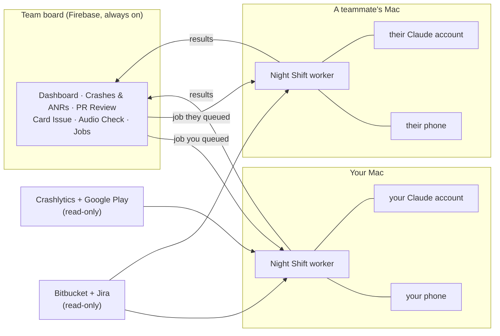

# Night Shift

**A crash, ANR and code-review desk for the MyZesty Android app that works while you don't.**

Night Shift gathers every crash and ANR from Crashlytics and Google Play, finds the root cause, reproduces it on a real
phone, drafts a fix and checks it on the phone. It reviews pull requests with a panel of Claude reviewers, explains Jira
cards from their screen recordings, and checks that audio stays clean where clips are cut.

Everything shows up on one team board in the browser. Each person's jobs run on **their own Mac**, with **their own
phone** and **their own Claude account**, so nobody waits for, or depends on, anyone else's machine.

---

## Contents

- [How it works](#how-it-works)
- [The tools](#the-tools)
  - [Dashboard](#dashboard)
  - [Crashes & ANRs](#crashes--anrs)
  - [PR Review](#pr-review)
  - [Card Issue](#card-issue)
  - [Audio Check](#audio-check)
  - [Jobs](#jobs)
- [Install](#install)
- [Update](#update)
- [Daily routine](#daily-routine)
- [Safety](#safety)
- [Troubleshooting](#troubleshooting)
- [FAQ](#faq)

---

## How it works



- **The board** is a website on Google Firebase. It's up even when every Mac is off. Sign in with your
  @msd-my.com address (a one-click link by email, no password).
- **A worker** runs in the background on each person's Mac. It picks up the jobs **you** queue and runs them on your
  Mac. The board host's Mac also runs the daily crash gathering at 08:00 (Egypt), and covers anyone whose Mac is off.
- **Nothing is ever committed, pushed or merged** by Night Shift. Production (Crashlytics, Play, Bitbucket, Jira) is
  only read.

---

## The tools

| Tool | What it answers | Needs a phone | Typical time |
|---|---|:---:|---|
| [Dashboard](#dashboard) | How is the latest build doing? What's new or spiking? | no | live |
| [Crashes & ANRs](#crashes--anrs) | Which crashes matter, why do they happen, can we reproduce and fix them? | to reproduce | 2 min to gather · 5–15 min per root cause · 20–90 min per repro |
| [PR Review](#pr-review) | Is this pull request safe to merge? | no | 10–25 min |
| [Card Issue](#card-issue) | What really causes the bug in this Jira card? | no | 15–30 min |
| [Audio Check](#audio-check) | Does this branch keep audio clean at clip cuts? | yes | 30–45 min |
| [Jobs](#jobs) | What's running, for whom, on which Mac? | no | live |

### Dashboard

The first page you see.

- **Crash-free and ANR-free users** per build, from Google Play vitals.
- **What changed since your last visit:** new problems in the last 3 days, problems spiking now, jobs that finished,
  repros found.
- **Top problems** for the current release, and a picture of the lab phone's state.

**Use it** every morning for one minute to decide what to look at.

### Crashes & ANRs

Every crash and ANR of the last releases, with Google Play and Crashlytics **paired into one row** when they're the
same problem.

**What you see per problem:** users and events in each source, last seen, a 14-day trend, devices, the stack
(symbolized), and a pipeline: **Root cause → Reproduced → Fix verified**.

**Filters** (they stay in the page link, so you can send a filtered list to someone):

| Filter | Options |
|---|---|
| Kind | crashes, ANRs |
| Source | in both, Play only, Firebase only |
| Code layer | Native (C++), App code (Java/Kotlin), Kotlin only, Java only, System / third-party |
| Progress | not analysed, root cause found, reproduced, not reproduced, fix verified, not fixed |
| Version | any release in scope |
| Sort | most users, most events, rising fastest, newest, oldest |

**How to use it:**

1. Open a problem.
2. **Analyse:** Claude reads the stack, the code and the field data and writes the root cause, with a diagram and the
   owning area (engine, app, third-party).
3. **Reproduce:** the worker builds the app in its own folder (never your working copy), installs it on **your** phone
   and drives the app like a user with a recipe made for this crash. It climbs a ladder from the most realistic
   trigger to forced timing, and stops when the phone shows the same crash or ANR stack as the field. You get the
   steps, logs and a video.
4. **Draft fix:** a patch, rebuilt and re-run on the phone until the crash is gone (or it reports why not). You take
   the patch into your own branch.

**Sync now** re-gathers on demand (about 2 minutes). It runs by itself every morning at 08:00 (Egypt).

### PR Review

Opens a Bitbucket pull request and reviews it the way a careful senior engineer would.

**How to use it:**
- **Review open PRs** reviews every new or changed open PR in the main repo.
- **Paste a PR link** reviews one PR from **any** repo of the project (`video_gles3jni`,
  `android-video-editor-module`, `java-common`, `gallerypicker`).

**What happens:**

1. **Classify** the PR (crash fix, ANR fix, behaviour fix, feature, refactor).
2. **Blind review:** 8 specialist reviewers read only the code, never the author's description: general,
   silent failures, simplify, performance, memory, placement/SOLID, lifetime/concurrency, ANR risk. They work from a
   **change map** of callers, threads and shared state, and can open the Kotlin code that calls the native code.
3. **JNI check (code, not AI):** for native PRs, every registered native method is compared with the Kotlin
   `external fun` declarations. It reports only mismatches **the PR adds**; one mismatch stops the app from starting.
   If the PR description links the Kotlin PR it ships with (for example a java-common PR), that PR's code is used
   instead of the sprint branch.
4. **Two judges** try to prove or refute each finding against the code. Every finding ends as **Verified**,
   **Suspected** or dropped.
5. **Description check:** the author's claims are compared with what the code actually does.
6. **Verdict by rule, not by a model:** only a Verified problem can block.

**What you get:** the verdict (Approve / Changes / Blocking), each finding with file:line, a step-by-step replay of how
the bug happens, the suggested fix as code, and QA steps. Answer each finding with **Agree / Not a problem /
Ask author**: the reviewers learn from it.

**Cost:** a full review uses roughly $3–8 of Claude usage on the account of whoever runs it.

### Card Issue

Takes a Jira card (key like `MZ-12345` or the link) and finds the root cause in the code.

**How to use it:** paste the card, optionally name the branch to check and add a note, then **Read card**.

**What happens:** it reads the description, comments and **every frame of the screen recording**. It maps what the
user did to the code paths (native and Kotlin), hunts for causes with three reviewers (root cause, user flow, threads),
and has two judges check each one. It also checks the content the app downloads (effects, transitions) when the
cause could be there.

**What you get:** per issue in the card: **explained** (with the code lines), **likely**, **server content**,
**feature gap** (not built in the app), or **unexplained**. Plus a replay from the video to the code, QA steps and a
suggested fix.

### Audio Check

Checks that a branch keeps the sound clean where a clip is cut. This catches dropouts, repeats, clicks and level dips.

**How to use it:**

1. Type a branch or commit (or `before-pr-NNNN` for the code just before a PR), and press **Run Audio Check**.
2. Open the check. Press **▶ cut N** to listen 1.5 s around each cut.
3. Tick 2–4 checks and press **Compare** to see them side by side, with a cut-by-cut listening table.

**What happens:** the worker builds the branch (or only its audio engine inside today's app, for old branches), makes
a test project on **your** phone from a fixed music clip, splits it into 7 pieces and exports it **3 times**. Each
export is measured at every cut:

| Measured at each cut | Clean when |
|---|---|
| Audio repeated or skipped | under 0.1 ms |
| Silent gap | under 1 ms |
| Level | at least 85% of the level around it |
| Error against the original clip | −30 dB or lower |
| Click | not sharper than the same spot in the original |

The result is the **median** of the 3 exports. Each test shows in how many exports it passed, so flaky results are
visible. Every check also measures **today's code** as a control, and a warning appears if today's code scores
outside its usual range.

### Jobs

Every job: who asked, on whose Mac it runs, its live log and its result. **Cancel** stops a queued or running job.
If the person's Mac is offline, the job says so instead of waiting silently.

---

## Install

You need:
- a **Mac**;
- your **`video_gles3jni` checkout** that builds in Android Studio;
- **Homebrew**, **Node/npm**;
- **Claude Code** signed in with your company account;
- an Android **phone with USB debugging**, for Reproduce and Audio Check.

```bash
brew install android-platform-tools ffmpeg
npm install -g firebase-tools
git clone https://github.com/AbdelrahmanTarekMahmoudAbdelrazek/nightshift.git ~/nightshift
cd ~/nightshift && ./setup.sh ~/video_gles3jni
```

`setup.sh` takes about 15 minutes, once. It:

1. checks your tools and Python packages (it asks before installing anything);
2. links Night Shift into your checkout (`tools/nightshift`, `tools/stress`, hidden from your git status) and adds the
   debug-only lab remote control (`app/src/debug`), which is never part of a release build;
3. asks for your **Bitbucket API token** (Bitbucket → Personal settings → API tokens, scopes `read:repository` and
   `read:pullrequest`). It's stored only in `~/.config/nightshift/` on your Mac;
4. asks **Join or create**:
   - **j: join the team board** (recommended). Use the join pack the board owner sent you
     (`nightshift-join-<you>.zip`).
   - **c: create your own private board.** A free Firebase project in your Google account. Two clicks in the
     Firebase console, with links shown.
5. finds your phone, writes your settings, installs the Claude review plugins and starts your worker in the background.

**Board owner: inviting a teammate**

```bash
cd ~/video_gles3jni
python3 tools/nightshift/joinpack.py their.name@msd-my.com
```

Send the zip **privately** (AirDrop or a password manager, never a channel or GitHub), then delete your copy.
It contains the board's write key.

**Crash data:** the crash gathering reads Crashlytics with your `firebase login`, so your Google account needs read
access to the MyZesty Firebase project. Google Play vitals are optional: run `python3 tools/nightshift/sentinel.py
play-login` once.

---

## Update

```bash
cd ~/nightshift && git pull && ./setup.sh ~/video_gles3jni
```

The worker uses the new code from its next job. `setup.sh` only redoes what's missing.

**Board owner, publishing a new version:**

```bash
cd ~/video_gles3jni && python3 tools/nightshift/kit_build.py
cd tools/nightshift/out/kit/nightshift && git add -A && git commit -m "Update" && git push
```

`kit_build.py` copies only code, prompts and pages, never results or keys. It stops if anything looks like a key.

---

## Daily routine

| When | Where | What |
|---|---|---|
| Morning, 5 min | Dashboard → Crashes & ANRs | Check what's new or spiking; **Analyse** the top ones; **Reproduce** the ones in your area |
| You open or review a PR | PR Review | Paste the link; read the verdict; answer each finding |
| A Jira card lands on you | Card Issue | Paste the card; start from the explained cause and its code lines |
| You change audio, export or timeline code | Audio Check | Run your branch; listen to the cuts it flags |

Full day-to-day guide: [SOP.md](SOP.md).

---

## Safety

- **Read-only on production:** Crashlytics, Google Play, Bitbucket, Jira and the app's content servers.
- **Never commits, pushes or merges.** Fixes are patches you apply yourself.
- **Never touches your working copy.** Crash builds and PR checkouts live in their own folders (`~/.nightshift_lab`,
  `~/.nightshift_pr`).
- **Keys stay on your Mac** in `~/.config/nightshift/` (mode 600). This repository contains none.
- **Free plan:** the board runs on Firebase's free Spark plan.
- **Your phone:** between jobs you can use it normally. The next phone job installs its own build again (and removes
  a Play/release build once if needed). Don't unplug it while a Reproduce or Audio Check is running.

---

## Troubleshooting

| Problem | Fix |
|---|---|
| The board shows only the sidebar, or a red box | Hard-refresh (Cmd+Shift+R). The red box names the cause (blocked network, old browser) |
| My job stays "queued" | Jobs tab: if it says your Night Shift is offline, start your Mac's worker: `launchctl kickstart -k gui/$(id -u)/com.nightshift.worker` |
| Worker log | `tail -f /tmp/nightshift-worker.log` |
| "could not read it from Bitbucket" | Your token lacks a scope or access to that repo: make a new one with `read:repository` + `read:pullrequest` |
| Reproduce fails at the first screen | Unlock the phone, keep the screen on, close dialogs. A different phone model may need its first recipe step adjusted |
| `setup.sh: \r: command not found` | `git config --global core.autocrlf input`, then clone again |

---

## FAQ

**Does it use my Claude account?**
Yes, for the jobs you queue: reviews, root causes and fixes. Audio Check and the crash gathering use no Claude.

**Can someone else's job use my phone?**
Only if you're the board host and their Mac is offline. Then your Mac covers their job after waiting 90 seconds.

**Does it work for repos other than video_gles3jni?**
Yes. PR Review takes a link from any repo in the project. Everything project-specific lives in
`tools/nightshift/nightshift.yaml` (`profile:`).

**What if the board owner's Mac is off?**
The board stays up, and everyone's own jobs still run on their Macs. The daily gathering is picked up by another Mac
after 15 minutes.
